# 思考问题
此类问题是否适合在网络中使用归一化/标准化？
- 对于这个问题弹幕直径和速度量纲不同、量级相近但不统一，可以做也可以不做，那就做呗

神经网络在此类数量关系不明确的回归问题中，相比于采用固定公式的回归模型，有什么优势？
- 采用固定公式的回归模型需要先观察出大概是啥样
- 再来几个特征可以直接套用

在实际应用中，如何选择合适的激活函数和损失函数？
激活函数

- 输出层最后的激活和任务目标相关，二分类 sigmoid（或直接BCEWithLogitsLoss）；多分类 softmax（或直接CrossEntropy)
- 隐藏层其实一般用relu了吧？？结合具体情况也有LeakyRELu等，毕竟sigmoid有梯度问题

损失函数
- 看输出（任务），回归/分类什么的
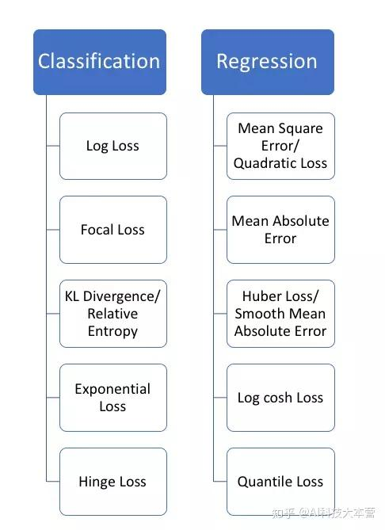

- 看数据分布
MAE&MSE：MAE损失适用于训练数据被离群点损坏的时候

还有类别是否平衡--》focal loss
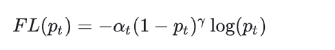

# 测试分析
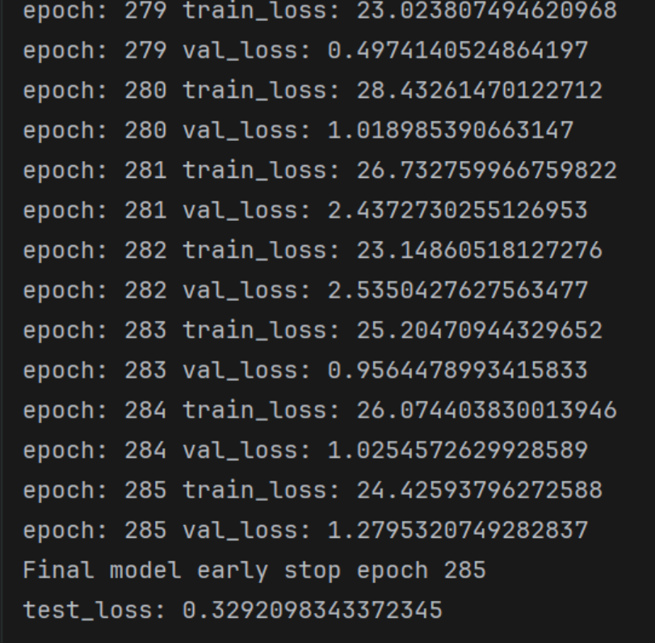
- why刚开始train和val的loss差距不大后面大
训练的时候开启 Dropout：每次前向随机屏蔽神经元，预测不稳定，loss 被拉⾼
eval 模式下 Dropout 关闭，全部神经元参与预测，预测稳定，loss 直接掉到 0.3 附近，和验证集就差不多了
前期⽹络没学好，权重乱，Dropout 扰动影响很⼩，所以⼀开始 train 和 val loss 差距不⼤
等收敛之后 Dropout 的效果就凸显出来了
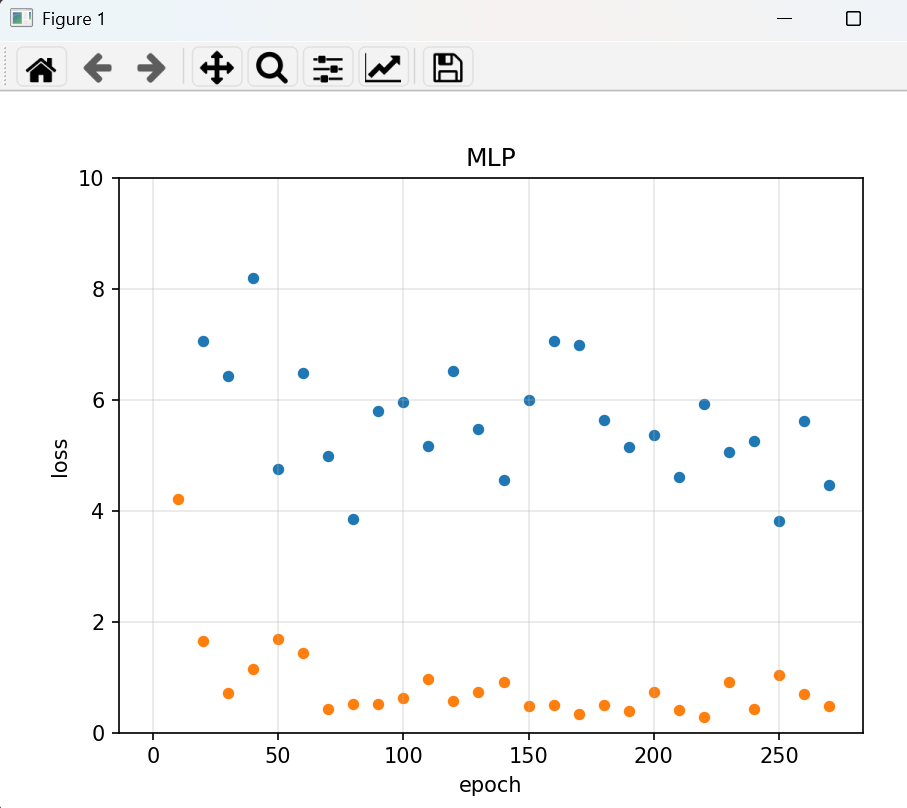
- 刚好仔细看题目时注意到有过拟合分析，我之前写代码时直接加了dropout和bn还有早停没有分析最初的，这里去掉这些可以观察到过拟合现象，训练集准确率下降，验证集准确率后面却上升
怪怪的，原来是我图像用成散点了
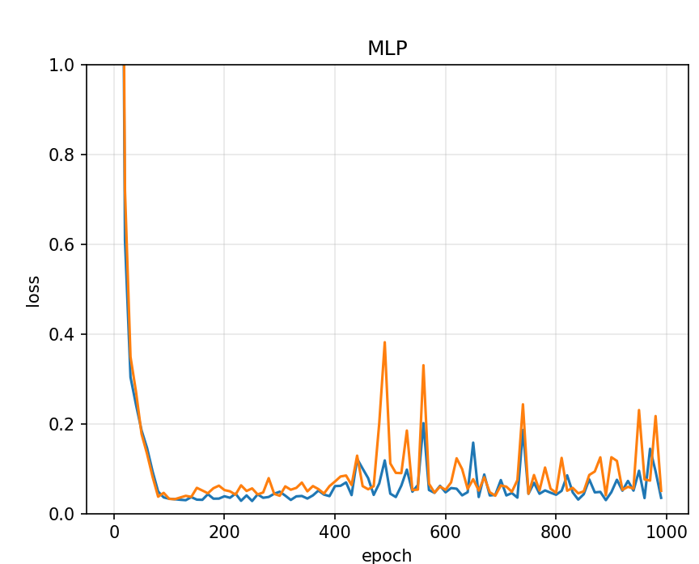
加上正则化，这里的train是有dropout时记录的
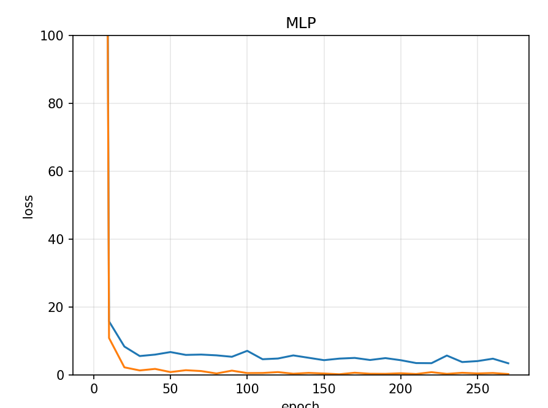

# 基础知识
1. 激活函数
将非线性特征引入网络中，if没有激活函数每层都相当于矩阵相乘,每一层输出都是上层输入的线性函数，无论神经网络有多少层，输出都是输入的线性组合
如果使用的话，激活函数给神经元引入了非线性因素，使得神经网络可以任意逼近任何非线性函数
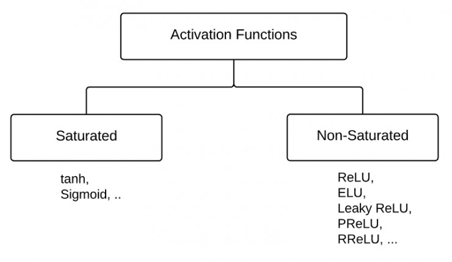
使用非饱和激活函数可以解决梯度消失（如果网络很深的话，会有这样的问题，一直更新不了）
比如说sigmoid，它的导数即使未进入饱和区输入不是很大也超过不了0.25，链式法则连乘衰减就越来越小了
首层几乎不更新，网络实际只有最后几层层在学习，等效容量退化成浅网络，就卡死了，而且越走越慢
- sigmoid输出范围是 0 到 1=》适合作为模型的输出函数用于输出一个0~1范围内的概率值（eg.表示二分类的类别或者用于表示置信度),but有梯度消失和要进行指数运算计算机算的更慢的问题
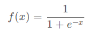
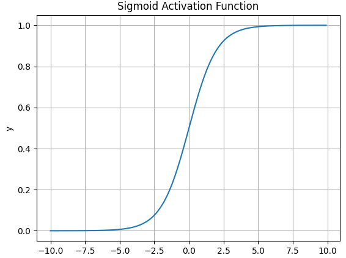
- tanh是sigmoid的变体
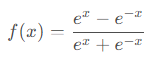
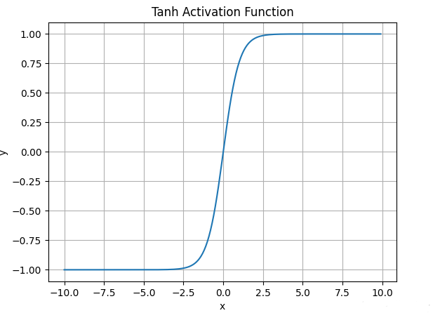
- ReLU
好处：解决了梯度消失而且计算简单
坏处也有：当输入为负时，梯度为0。这个神经元及之后的神经元梯度永远为0，不再对任何数据有所响应，导致相应参数永远不会被更新
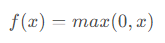
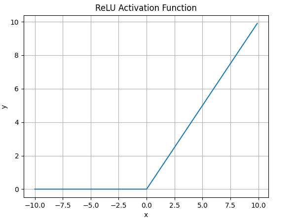
- Leaky ReLu
relu的plus,解决了dead问题
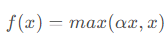
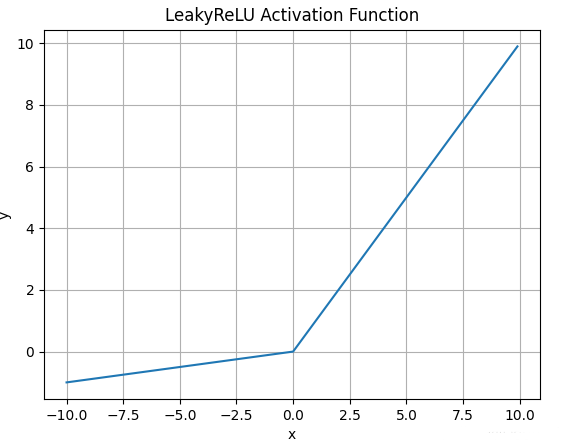

2. 正则化
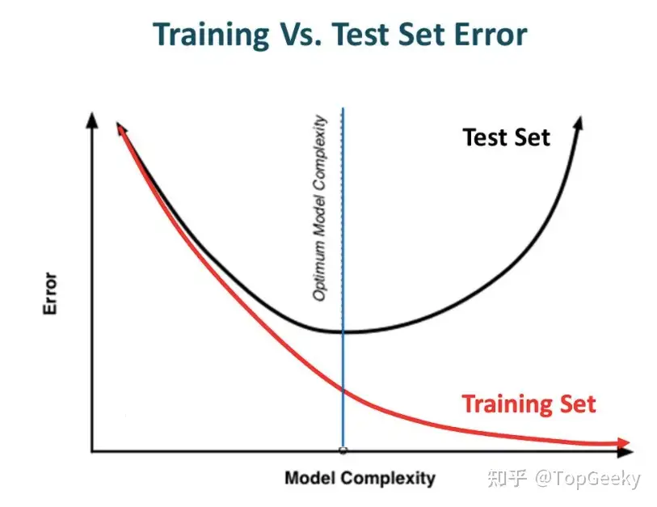
- 概念：为了解决过拟合（模型容量 >> 数据信息量时，网络会把噪声也背下来）问题，限制模型的复杂程度（让它不要去学习那些无关紧要的细节），的一种“约束”或“惩罚”机制
- 一般是在模型的损失函数中，加入一个代表模型复杂度的惩罚项
（1）L1正则化
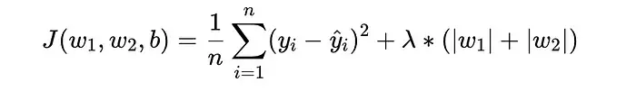
（2）L2正则化
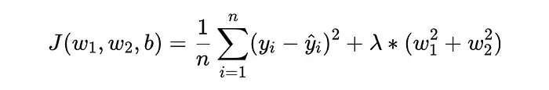
- dropout
训练时按 p 随机置零，让某个神经元的激活值以一定的概率p停止工作，可以使模型泛化性更强，because这样它就不会太依赖某些局部的特征
- 早停
验证损失不再下降就停（用验证集哦）
- 数据增强
一般图片可以翻转 / 裁剪 / 加噪，这种就直接增加信息量

3. 优化器
- BGD
批量梯度下降,一个epoch更新一次，梯度精准，但是更新慢
数据小or要求精度高时
- SGD
每次随机挑一个或者一组（mini-batch）数据来优化神经网络的参数
好处：保证精度的同时降低计算量，then网络可以应用于更大规模的数据上
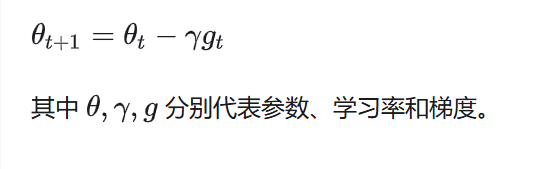
- SGD Momentum
有时会遇到震荡的问题，导致模型收敛过慢(每次迭代后梯度变化过大导致的)
解决这个问题的方法就是引入动量:抵消梯度中那些变化剧烈的分量
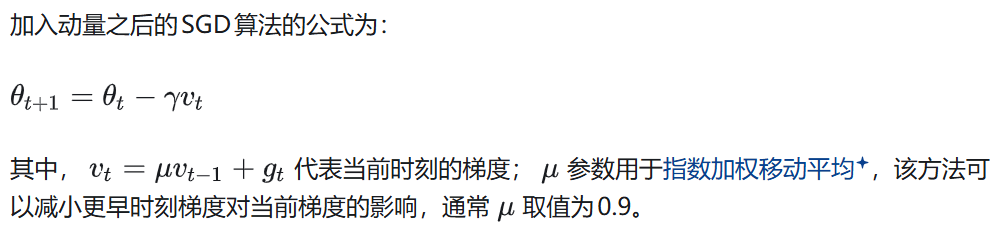
- AdaGrad
模型自动地调整学习率:减小之前震荡过大的参数的学习率，增大更新速率较慢的参数的学习率
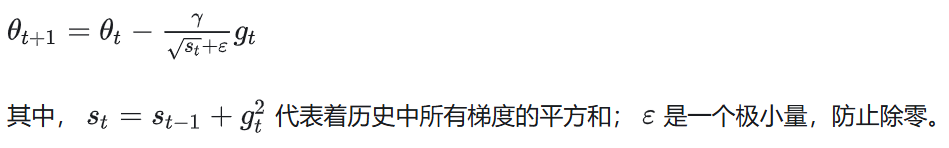
- RMSProp
AdaGrad算法因为要考虑所有的历史数据，导致st越来越大，学习率的分母变大了，学习率越来越小，模型收敛的速度变慢
于是指数加权移动平均法，减小更早的梯度对当前学习率的影响
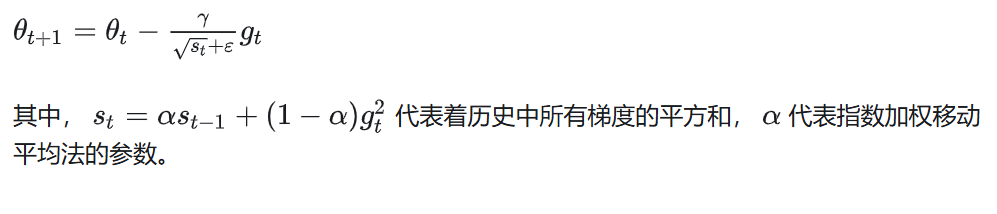
- Adam
SGD Momentum+RMSProp
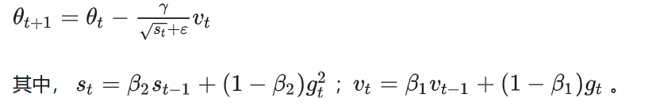

4. 损失函数
（1）回归任务
- MAE
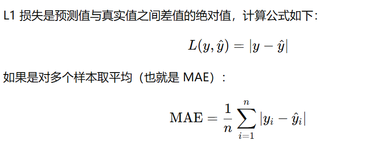
- MSE
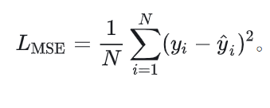
平方有两个作用：
正负误差不会互相抵消；大误差会被放大，对离群点比较敏感
（2）二分类
- BCEWithLogitsLoss
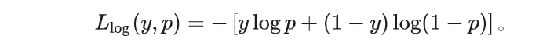
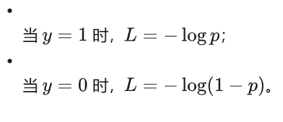
（3）多分类
- CrossEntropyLoss
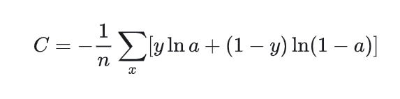
（4）自监督
- InfoNCE
（5）图像
- L1 像素
- 感知损失
- SSIM
（6）语义
- 余弦相似度损失

5. 参数初始化（大概的理解没有严格推导）
- 假如都设为相同值
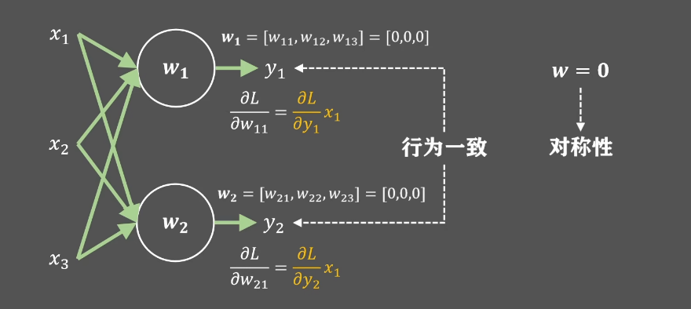
所有单元具有相同的初始化状态，所有的神经元都具有相同的输出和更新梯度，并进行完全相同的更新，这种初始化方法使得神经元间不存在非对称性-->模型效果bad
- 随机xavier(配 tanh /sigmoid/ 线性)
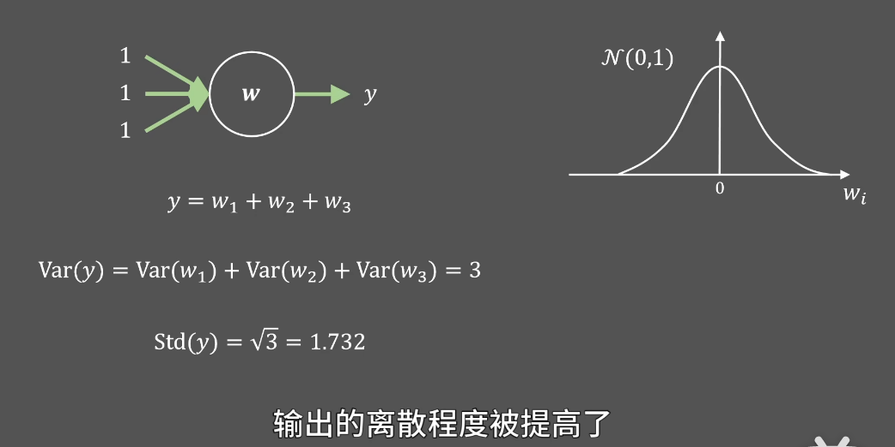
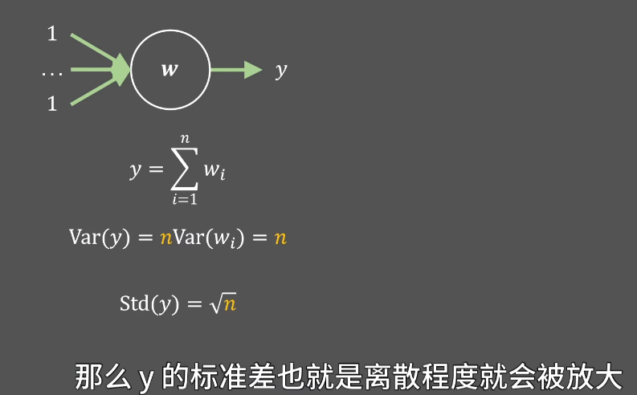
放大的y值会累积在反向传播的过程中，造成梯度爆炸
为了让训练稳定，y的方差要落在一个可控的范围内，eg=1
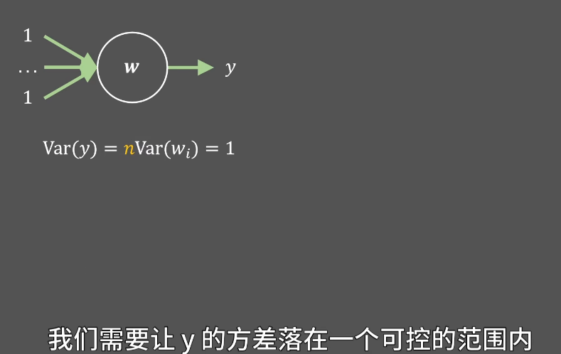
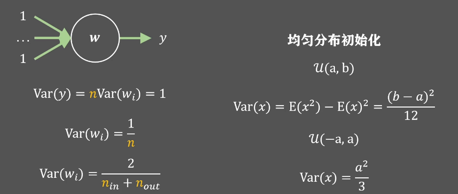
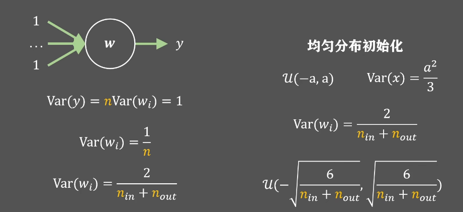
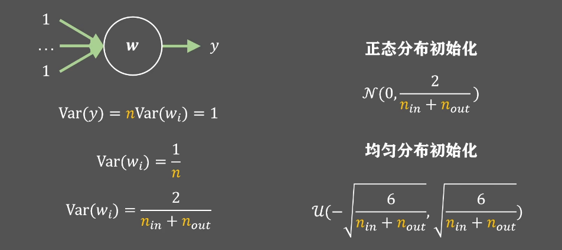
- Kaiming(配RELU)
ReLU 砍掉一半方差
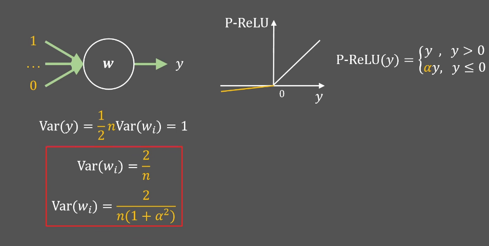
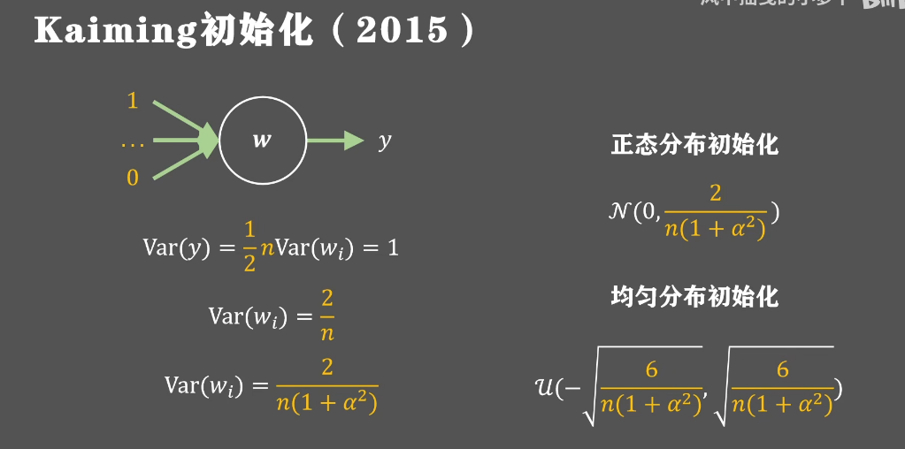